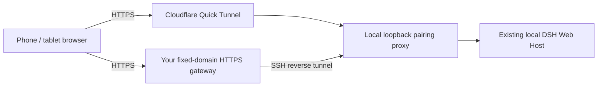

# dsh-remote-control

[简体中文](README.md) | English

Pair a phone browser with your running [DeepSeek Harness (DSH)](https://github.com/deepseek-ai/deepseek-harness). Continue the same sessions, send messages, answer questions, approve actions, and stop tasks from your phone. **DSH, project files, and provider configuration stay on the computer running DSH.**

Version 0.3.0 offers two HTTPS entries: the default Cloudflare Quick Tunnel needs no Cloudflare account or custom domain; optional SSH mode uses a fixed domain and an HTTPS gateway you manage. Neither mode needs a phone app. Remote access starts off by default.

This is an independent community plugin. For the current full phone experience, also install [dsh-mobile](https://github.com/slicenferqin/dsh-mobile), which adds a task-first phone workspace. Either plugin can be installed independently.

## Promo video

https://github.com/user-attachments/assets/763e9698-6479-40da-9685-b201a600c2e4

[Download MP4](https://github.com/slicenferqin/dsh-remote-control/releases/download/v0.2.1/DSH-Anywhere-30s.mp4) · [GIF preview](https://github.com/slicenferqin/dsh-remote-control/releases/download/v0.2.1/DSH-Anywhere-preview.gif) · [Cover](https://github.com/slicenferqin/dsh-remote-control/releases/download/v0.2.1/DSH-Anywhere-cover.png)

A 30-second promo in 16:9 at 1080p, 60 fps, with original music and sound effects, Chinese on-screen text, and no narration.

## Connection flow



| Mode | Entry and dependencies | Pairing and restart |
| --- | --- | --- |
| `quick` (default) | Local `cloudflared`; temporary `*.trycloudflare.com` domain. | A new tunnel may change domains. Pair again on a new domain. |
| `ssh` (optional) | Local OpenSSH, your own domain, a valid TLS certificate, and a restricted SSH relay account. | A fixed domain plus explicitly enabled local device storage can preserve pairing across controlled restarts. |

The DSH computer initiates the outbound SSH connection. The server terminates HTTPS and forwards requests to the local bridge. DSH, projects, and provider configuration do not need to move to a VPS. See the [stable HTTPS entry guide](docs/stable-entry.md) for configuration examples.

## Features

- Explicit local switch to enable or disable remote access; automatic startup is a separate opt-in.
- Short-lived, single-use pairing QR codes, with device-name confirmation before pairing.
- Multiple paired devices: four by default, configurable up to sixteen; rename or revoke each device separately.
- HTTP and WebSocket access to the existing DSH Host, with automatic credential renewal.
- Optional persistent pairing, SSH reconnection, and public health status that distinguishes enabled, online, and reconnecting.
- A `remote_control` agent tool for credential-free status, renaming, revocation, and disconnecting all devices. The tool cannot enable access or issue pairing codes; those actions remain user operations in local Settings.

## Compatibility

- Node.js **22.19 or later**, DSH installed, and `pnpm` on `PATH` for profile package management.
- The declared DSH range remains **`>=0.2.1-rc.2 <0.3.0`**. Plugin version 0.3.0 does not require DSH 0.3.0. DSH plugin APIs are pre-stable; check compatibility before upgrading.
- Validated with a **DSH 0.2.1-rc.2 source build on macOS arm64**, including live browser/tunnel use. This is not an end-to-end validation claim for every OS, browser, or mobile network.
- The DSH Web origin must use **`localhost`, `127.0.0.1`, or `[::1]`**. The default `dsh web` listener uses `127.0.0.1`. LAN addresses and wildcard binds such as `0.0.0.0` or `[::]` are unsupported by this bridge.

## Install and start

Install the tagged community release into the Web profile:

```sh
dsh plugin --profile web add github:slicenferqin/dsh-remote-control#v0.3.0
```

For the default Quick mode, install `cloudflared` on the computer running DSH:

```sh
# macOS
brew install cloudflared
```

```powershell
# Windows
winget install Cloudflare.cloudflared
```

For other platforms, use the [official cloudflared releases](https://github.com/cloudflare/cloudflared/releases). Put the executable on `PATH`, or set `cloudflaredPath`. SSH mode uses local OpenSSH instead of cloudflared; prepare the gateway and configuration using the [stable entry guide](docs/stable-entry.md).

For the full phone experience, optionally add the phone workspace to the same profile:

```sh
dsh plugin --profile web add github:slicenferqin/dsh-mobile#v0.1.0
```

Start DSH with `dsh web` (or `dsh --profile web`). If it is already running, restart that profile after the CLI installation, then refresh the local page. Open the authenticated local browser page printed by DSH. Release tarballs are also available from [GitHub Releases](https://github.com/slicenferqin/dsh-remote-control/releases); npm publication is not required.

## Pair and use

1. On the computer, open **Settings → Remote control** and enable remote access.
2. Wait for the public entry check and QR code. Quick Tunnel startup can take nearly a minute; SSH mode requires a configured fixed entry first.
3. Scan the QR code with the phone camera and open the pairing page in a browser.
4. **Fill in or confirm the device name, then tap “配对并进入” (Pair and enter).** The page does not submit automatically. Invalid names do not consume the pairing code.
5. Use the existing DSH sessions from the phone. Browsers share one Host and its records, while each browser can select a different session.
6. Rename or revoke devices in the computer's Remote control settings. With dsh-mobile installed, a paired phone can also rename itself under **Device**.

The computer must stay awake, online, and running DSH. Generate a new QR code for each additional device. Pairing links last two minutes by default and can be claimed once; generating a new code invalidates the previous unclaimed one.

### Return from an already paired browser

Save the remote homepage, such as `https://dsh.example.com/` for a fixed entry or the current Quick Tunnel homepage. Do not use the one-use pairing address as a daily bookmark. Reopening a pairing page after its one-use secret has been cleared tries that browser's existing refresh credential, confirms that new cookies took effect, and enters the homepage.

An actual top-level HTML homepage navigation that receives a pairing 401 can show the same recovery page. It attempts recovery once and returns to the fixed homepage. API requests, POST, WebSocket, and other business paths do not automatically redirect. Failed recovery allows an explicit retry or a new pairing.

Browser credentials stay in the cookies of the browser that completed pairing. Another browser, a new private session, or cleared site data needs a new QR code. **After changing domains, pair each device once on the new domain. Old-domain credentials never migrate.**

## Persistent pairing and lifetime

Access credentials last **8 hours** by default. A rotating refresh credential has a **rolling 10-day** lifetime, reset after each successful refresh. The browser normally renews access **5 minutes before expiry**, and can recover after a background pause or a fresh page/browser startup while its refresh credential remains valid.

`persistDevices` defaults to `false`. Enabling it requires an absolute `deviceStorePath`. Local storage contains only the **current refresh credential's SHA-256 hash, expiry, device ID/name/timestamps and other metadata, and entry enable/disable intent**. It never stores raw refresh or access credentials, Core cookies, the DSH launch token, or pairing secrets. Files are written atomically with `0600` permissions; corrupt files and permission errors fail closed.

| Operation | Pairing and startup intent |
| --- | --- |
| Ordinary browser refresh | Does not restart the Host; valid browser credentials remain usable. |
| Controlled plugin reload/unload or DSH restart with persistence enabled | Preserves refresh grants and recorded intent; restoration still requires the same domain. Old access is not restored. A valid refresh exchanges a new Core cookie for the current Host while preserving the device ID. |
| Explicit local Off, or agent `disable` | Revokes every device, closes the tunnel and connections, and records Off in persistent storage. Restart does not automatically revive the entry. |
| Revoke one device | Invalidates its grant and closes its connections; a new QR code is required to connect again. |
| Change domain or let the refresh grant expire | Old authorization cannot be restored; pair again. |

`autoStart` defaults to `false`. Even saved pairing then requires the user to enable the entry locally after restart. **Explicitly setting `autoStart: true` permits automatic enablement, including the first startup with no saved intent.** With persistence enabled, a recorded Off takes precedence; the user must enable the entry locally again to resume automatic startup. Without persistence, Off is not recorded across processes.

The device store supports one writer; give each local instance a separate state file. The refresh rotation's **120-second grace exists only in memory**. If a rotation reaches disk and the process crashes before the browser receives or applies the new cookies, the old refresh cannot recover across that restart and pairing is required again.

## Health status

Enabled does not mean publicly reachable. `connection.status` is `checking` during verification, `online` when the latest public probe reaches this bridge, `reconnecting` during a temporary failure and retry, or `offline` when the entry is offline or has an error needing attention. SSH reconnection retains valid pairings. Sleep, loss of connectivity, SSH errors, or certificate failures still interrupt access.

Public **`GET /__dsh_remote_health`** checks the exact Host/Origin, then responds before device authentication:

```json
{"ok":true,"service":"dsh-remote-control","entryId":"<this-bridge-id>"}
```

The response is `no-store`, sets no cookies, and contains no device count, paths, pairing secret, or credentials. `entryId` changes with each bridge instance; tunnel probes match it to avoid accepting another leftover gateway. A successful health response grants no DSH access.

## Add a workspace

In the desktop interface, **Add workspace** (`AddWorkspace`) opens a directory chooser in the browser where you clicked it. The chooser browses directories on the computer running the DSH Host. A remote browser therefore selects a Host directory from its own page.

While the dsh-remote-control bundle is enabled in a profile, local browsers in that profile also use the browser chooser, including when the remote-access switch is off. This is a profile-wide setting, independent of when the tunnel starts. Core's automatic picker chooses its backend at startup from local conditions; starting a tunnel later does not change that choice.

The bundle patch relies on the standard Web profile's default `directory-picker` row: it disables that automatic picker and explicitly adds Core's browse Host and browse Client. If you use a custom composition, ensure it has only one directory-picker backend active; remove or disable conflicting native, automatic, or duplicate browse backends.

## Configuration

Edit the plugin's configuration in DSH's plugin settings. These fields match the [configuration definition](index.js):

| Field | Default | Purpose / range |
| --- | --- | --- |
| `tunnelMode` | `quick` | Temporary `quick` tunnel or fixed `ssh` HTTPS entry. |
| `publicOrigin` | Empty string | Required for SSH, e.g. `https://dsh.example.com`; HTTPS on 443, without userinfo, a business path, query, or fragment. |
| `sshPath` | `ssh` | Local OpenSSH executable name or path. |
| `sshTarget` | Empty string | Required for SSH; a dedicated OpenSSH Host alias is recommended. |
| `sshConfigPath` | Empty string | Optional absolute local OpenSSH configuration path; reference private keys through SSH configuration. |
| `sshRemotePort` | `18380` | Server loopback listener port, integer 1024–65535; match the HTTPS gateway and SSH account restrictions. |
| `persistDevices` | `false` | Persist device refresh grants and entry intent. |
| `deviceStorePath` | Empty string | Required for persistence; absolute private local state-file path. HOME/profile paths are not guessed. |
| `autoStart` | `false` | Explicitly allow automatic startup; a persisted Off takes precedence. |
| `cloudflaredPath` | `cloudflared` | Quick-mode executable name or absolute path on the DSH computer. |
| `tunnelProtocol` | `http2` | Quick-mode `http2`, `quic`, or `auto`; HTTP/2 avoids depending on outbound UDP. |
| `startupTimeoutSeconds` | `60` | Tunnel startup timeout, integer 10–180 seconds. |
| `pairingTtlSeconds` | `120` | Single-use pairing lifetime, integer 30–600 seconds. |
| `deviceTtlHours` | `8` | Access credential lifetime, 1–168 hours. |
| `refreshTtlDays` | `10` | Rolling refresh lifetime, 1–90 days; must exceed the access lifetime. |
| `refreshAheadSeconds` | `300` | Renew this early, integer 30–3600 seconds; must be shorter than the access lifetime. |
| `refreshRetrySeconds` | `30` | Retry delay after temporary renewal failure, integer 5–60 seconds. |
| `maxDevices` | `4` | Maximum paired devices, integer 1–16. |
| `heartbeatSeconds` | `15` | Keepalive for the local management status stream, integer 5–60 seconds. |

Quick mode uses its own empty cloudflared configuration and leaves your existing configuration alone. Both modes retain a loopback bridge, without expanding DSH's listener or trust list. If a custom listener causes `LOOPBACK_REQUIRED`, restart DSH with `dsh web --host 127.0.0.1` (or `--host ::1`).

## Security scope and limits

**A paired device receives owner access to this DSH Host, including available local-file and command capabilities, subject to the Host's permission policy.** Pair only browsers you trust. There is no read-only role or exclusive control lock, and pairing does not lock the computer. This operates DSH sessions; it is not OS screen sharing or general desktop control.

Pairing secrets are kept in URL fragments and claimed through a same-origin POST, so opening a link preview does not consume a code. The DSH launch token is not sent to the phone or placed in the QR code or logs. Per-device access and refresh cookies use **HttpOnly, Secure, and SameSite=Strict**; client JavaScript does not read their values. The bridge also uses DSH authentication and validates external Host/Origin headers. Local authenticated Settings alone expose enable/pair management endpoints; the remote proxy blocks management endpoints and `/connect`.

Cloudflare carries Quick-mode HTTPS traffic. Your gateway terminates TLS in SSH mode, and belongs within the trust boundary. Availability also depends on the computer, network, server, and certificate maintenance. Quick provides no fixed domain; SSH mode cannot keep a sleeping or stopped local DSH available. LAN targets, wildcard listeners, and Cloudflare named tunnels remain unsupported.

## Development and tests

Source, build scripts, and tests are included so the client bundle can be rebuilt. From a checkout or extracted source package:

```sh
pnpm install --ignore-scripts
pnpm run build
pnpm run check
pnpm test
```

Behavior tests cover pairing, expiry, exact origin checks, HTTP/WebSocket forwarding, refresh rotation, persistent grant restoration/revocation, public health, SSH cancellation/reconnection, and client health-marker gating. Test your actual phone, certificate, and network combination as well. For local development, install the checkout with `dsh plugin --profile web add .` from this repository's root, then restart the Web profile and refresh its page.

## License

[MIT](LICENSE).
