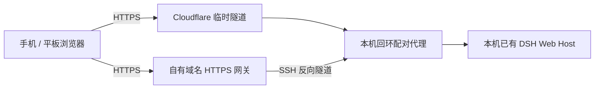

# dsh-remote-control

简体中文 | [English](README.en.md)

将手机浏览器配对到正在运行的 [DeepSeek Harness（DSH）](https://github.com/deepseek-ai/deepseek-harness)，继续同一批会话、发送消息、回答问题、审批操作或停止任务。**DSH、项目文件和服务商配置始终留在运行 DSH 的电脑上。**

0.3.0 提供两种 HTTPS 入口：默认的 Cloudflare Quick Tunnel 无需 Cloudflare 账号或自备域名；可选的 SSH 模式使用你管理的固定域名与 HTTPS 网关。两种模式均无需手机客户端，默认不自动开启远程入口。

这是独立维护的社区插件。当前完整手机体验建议同时安装 [dsh-mobile](https://github.com/slicenferqin/dsh-mobile)，获得以任务为中心的手机工作台。两个插件也可以分别独立安装。

## 宣传片

https://github.com/user-attachments/assets/763e9698-6479-40da-9685-b201a600c2e4

[下载完整 MP4](https://github.com/slicenferqin/dsh-remote-control/releases/download/v0.2.1/DSH-Anywhere-30s.mp4) · [GIF 预览](https://github.com/slicenferqin/dsh-remote-control/releases/download/v0.2.1/DSH-Anywhere-preview.gif) · [封面](https://github.com/slicenferqin/dsh-remote-control/releases/download/v0.2.1/DSH-Anywhere-cover.png)

30 秒宣传片，16:9、1080p 60 fps，使用原创音乐与音效，中文画面，无口播。

## 连接方式



| 模式 | 入口与依赖 | 配对与重启 |
| --- | --- | --- |
| `quick`（默认） | 本机 `cloudflared`，临时 `*.trycloudflare.com` 域名。 | 新隧道可能更换域名；新域名需要重新配对。 |
| `ssh`（可选） | 本机 OpenSSH、自有域名、有效 TLS 证书及受限 SSH 中继账户。 | 固定域名配合显式启用的本机设备存储，可在受控重启后恢复配对。 |

SSH 连接由 DSH 电脑向中继服务器发起。服务器只承担 HTTPS 终止和到本机桥接的转发；无需将 DSH、项目或服务商配置搬到 VPS。完整配置见[固定 HTTPS 入口指南](docs/stable-entry.md)。

## 功能

- 在本机设置显式开启或关闭远程入口；默认关闭，自动启动需要单独配置。
- 短时、一次性配对二维码，确认设备名后才提交配对。
- 默认支持四台配对设备，可配置到十六台；可逐台重命名和撤销。
- 通过 HTTP / WebSocket 访问现有 DSH Host，并自动续期凭证。
- 可选持久配对、SSH 自动重连，以及区分已启用、在线和重连中的公网健康状态。
- `remote_control` agent 工具可查看不含凭证的状态、重命名、撤销设备或断开所有设备。工具不能开启入口或签发配对码；这些操作仍由用户在本机设置中完成。

## 兼容性

- **Node.js 22.19 或更新版本**，已安装 DSH；profile 包管理需要 `PATH` 中有 `pnpm`。
- 声明的 DSH 版本范围保持为 **`>=0.2.1-rc.2 <0.3.0`**。插件版本 0.3.0 不代表它要求 DSH 0.3.0。DSH 插件 API 尚未稳定，升级前请核对兼容性。
- 已在 **DSH 0.2.1-rc.2 源码构建版、macOS arm64** 上完成 live 浏览器和隧道验证；这不代表所有操作系统、浏览器和手机网络均经过端到端验证。
- DSH Web origin 的主机名必须是 **`localhost`、`127.0.0.1` 或 `[::1]`**。默认 `dsh web` 监听 `127.0.0.1`。桥接不支持 LAN 地址或 `0.0.0.0`、`[::]` 等通配绑定。

## 安装与启动

通过 GitHub tag 将社区发行版安装到 Web profile：

```sh
dsh plugin --profile web add github:slicenferqin/dsh-remote-control#v0.3.0
```

默认 Quick 模式需要在运行 DSH 的电脑上安装 `cloudflared`：

```sh
# macOS
brew install cloudflared
```

```powershell
# Windows
winget install Cloudflare.cloudflared
```

其他平台使用 [cloudflared 官方发行版](https://github.com/cloudflare/cloudflared/releases)。将可执行文件加入 `PATH`，或设置 `cloudflaredPath`。SSH 模式改用本机 OpenSSH，不依赖 cloudflared；先按[固定入口指南](docs/stable-entry.md)准备网关与配置。

如需完整手机体验，可在同一 profile 加装手机工作台：

```sh
dsh plugin --profile web add github:slicenferqin/dsh-mobile#v0.1.0
```

使用 `dsh web`（或 `dsh --profile web`）启动。若 DSH 已运行，CLI 安装后请重启该 profile，再刷新本机页面。打开 DSH 输出的已认证本机浏览器入口。[GitHub Releases](https://github.com/slicenferqin/dsh-remote-control/releases) 也提供发行压缩包，无需发布到 npm。

## 配对与使用

1. 在电脑打开 **设置 → 远程控制**，开启远程入口。
2. 等待公网健康确认与二维码。Quick Tunnel 首次启动可能接近一分钟；SSH 模式需先配置固定入口。
3. 手机相机扫码，在浏览器打开配对页。
4. **填写或确认设备名称，再点击「配对并进入」。** 页面不会自动提交；无效名称不会消耗配对码。
5. 手机进入现有 DSH 会话。不同浏览器共享同一 Host 及记录，但可以各自选择不同会话。
6. 在电脑的远程控制设置中重命名或撤销设备。安装 dsh-mobile 后，已配对手机也可在 **设备** 中修改自己的名称。

电脑需要保持唤醒、联网并持续运行 DSH。每增加一台设备请生成新二维码。配对链接默认两分钟有效，只能领取一次；生成新码会使未领取的旧码失效。

### 已配对设备再次进入

请保存远程首页，例如固定入口的 `https://dsh.example.com/`，或本轮 Quick Tunnel 的首页，不要把一次性扫码地址当作日常入口。重新打开已清除一次性码的配对页时，会尝试使用该浏览器已有的刷新凭证，确认新 Cookie 已生效后进入首页。

真正的顶层首页 HTML 导航遇到配对 401 时，也可显示同一恢复页面。它最多自动恢复一次并返回固定首页；API、POST、WebSocket 和其他业务路径不会自动跳转。恢复失败时可显式重试或重新配对。

浏览器凭证只保存在完成配对的浏览器 Cookie 中；换浏览器、使用另一个隐私会话或清除站点数据后，需要新的二维码。**更换域名后，每个设备都要在新域名首次配对一次，旧域凭证不会迁移。**

## 持久配对与有效期

访问凭证默认有效 **8 小时**。刷新凭证采用**滚动 10 天**有效期，每次成功刷新重新计时。浏览器通常在访问凭证到期前 **5 分钟**续期；只要刷新凭证有效，后台恢复、重新打开页面或浏览器冷启动时也可透明续期。

`persistDevices` 默认 `false`。启用后必须指定绝对的 `deviceStorePath`。本机存储仅记录**当前刷新凭证的 SHA-256 hash、到期时间、设备 ID/名称/时间等元数据及入口开关意图**，不保存原始刷新或访问凭证、Core Cookie、DSH 启动 token 或配对码。文件以原子方式、`0600` 权限写入；坏文件和权限错误会拒绝恢复。

| 操作 | 对配对与启动意图的影响 |
| --- | --- |
| 普通页面刷新 | 不重启 Host；有效浏览器凭证仍可使用。 |
| 持久化启用后的受控插件重载、卸载或 DSH 重启 | 保留设备刷新授权和已记录的开关意图；恢复仍要求同一域名。旧 access 不恢复，下次凭有效 refresh 重新兑换当前 Host 的 Core Cookie，设备 ID 保持。 |
| 用户在本机主动关闭，或 agent 调用 `disable` | 撤销全部设备、关闭隧道与连接，并在持久存储中记为 Off；重启不会自动复活入口。 |
| 撤销单台设备 | 使其授权失效并关闭该设备连接；再次连接需要新二维码。 |
| 更换域名或刷新授权到期 | 旧授权不能恢复，需要重新配对。 |

`autoStart` 默认 `false`，即使已保存配对，重启后也需用户在本机重新开启入口。**显式配置 `autoStart: true` 才会尝试自动开启，包括尚无开关记录的首次启动。** 若同时启用持久化，已记录的 Off 优先；要恢复自动启动，需要用户再次在本机开启。未启用持久化时，Off 不会写入跨进程状态。

当前设备存储按单写入者设计，请为每个本机实例使用独立文件。刷新轮换的 **120 秒宽限仅存在于内存**；若新轮换已写盘、浏览器未收到或应用新 Cookie 时进程立即崩溃，旧 refresh 不能跨重启恢复，需要重新配对。

## 健康状态

入口“已启用”不等于公网当前可达。状态包含 `connection.status`：`checking` 为检查中，`online` 表示最近一次公网探测到达本次桥接，`reconnecting` 表示暂时不可达并正在重试，`offline` 表示入口离线或发生需处理的错误。SSH 连接恢复期间保留有效配对；电脑休眠、断网、SSH 或证书故障仍会中断访问。

公开的 **`GET /__dsh_remote_health`** 在精确 Host / Origin 检查后、设备鉴权前返回：

```json
{"ok":true,"service":"dsh-remote-control","entryId":"<this-bridge-id>"}
```

响应为 `no-store`，不签发 Cookie，也不包含设备数量、路径、配对码或凭证。`entryId` 每次创建桥接都会变化；隧道探测会核对它，避免把其他残留入口当作本次连接。该接口可达并不授予 DSH 访问权限。

## 添加工作区

在桌面界面点击 **添加工作区**（`AddWorkspace`），目录选择器会出现在发起操作的当前浏览器中。它浏览的是运行 DSH Host 的电脑上的目录；远程浏览器也可在自己的页面中选择 Host 目录。

只要该 profile 中启用了 dsh-remote-control bundle，本机浏览器也使用浏览器目录选择器，即使远程入口开关处于关闭状态。这是整个 profile 的设置，不取决于隧道何时启动。Core 的自动选择器会在启动时根据本机条件选定 backend，之后开启隧道不会改变该选择。

bundle patch 依赖标准 Web profile 默认的 `directory-picker` 行：禁用该自动选择器，并显式加入 Core 的 browse Host 和 browse Client。定制 composition 需要确保只启用一个目录选择 backend，移除或禁用冲突的原生、自动选择器或重复 browse backend。

## 配置

在 DSH 插件设置中编辑配置；以下字段与[配置定义](index.js)一致：

| 字段 | 默认值 | 含义及范围 |
| --- | --- | --- |
| `tunnelMode` | `quick` | `quick` 临时隧道或 `ssh` 固定 HTTPS 入口。 |
| `publicOrigin` | 空字符串 | SSH 模式必填，如 `https://dsh.example.com`；仅 HTTPS、443，不能含 userinfo、业务路径、query 或 fragment。 |
| `sshPath` | `ssh` | 本机 OpenSSH 可执行文件名或路径。 |
| `sshTarget` | 空字符串 | SSH 模式必填；推荐专用 OpenSSH Host 别名。 |
| `sshConfigPath` | 空字符串 | 可选的本机 OpenSSH 配置文件绝对路径；私钥通过 SSH 配置引用。 |
| `sshRemotePort` | `18380` | 服务器上的回环监听端口，整数 1024–65535，须与 HTTPS 网关及 SSH 账户限制一致。 |
| `persistDevices` | `false` | 是否持久保存设备刷新授权和开关意图。 |
| `deviceStorePath` | 空字符串 | 持久化启用时必填；本机私有状态文件的绝对路径，不自动猜测 HOME 或 profile。 |
| `autoStart` | `false` | 显式允许启动时自动开启；持久记录的 Off 优先。 |
| `cloudflaredPath` | `cloudflared` | Quick 模式使用的本机可执行文件名或绝对路径。 |
| `tunnelProtocol` | `http2` | Quick 模式的 `http2` / `quic` / `auto`；HTTP/2 不依赖出站 UDP。 |
| `startupTimeoutSeconds` | `60` | 隧道启动超时，整数 10–180 秒。 |
| `pairingTtlSeconds` | `120` | 一次性配对码有效期，整数 30–600 秒。 |
| `deviceTtlHours` | `8` | 访问凭证有效期，1–168 小时。 |
| `refreshTtlDays` | `10` | 滚动刷新有效期，1–90 天；必须长于访问凭证寿命。 |
| `refreshAheadSeconds` | `300` | 提前续期时间，整数 30–3600 秒；必须短于访问凭证寿命。 |
| `refreshRetrySeconds` | `30` | 临时续期失败后的重试间隔，整数 5–60 秒。 |
| `maxDevices` | `4` | 配对设备上限，整数 1–16。 |
| `heartbeatSeconds` | `15` | 本机管理页状态流的保活间隔，整数 5–60 秒。 |

Quick 模式使用独立的空 cloudflared 配置，不修改已有 Cloudflare 配置。两种模式都保留 loopback 桥接，无需扩大 DSH 的监听或信任列表。如果自定义监听触发 `LOOPBACK_REQUIRED`，请用 `dsh web --host 127.0.0.1`（或 `--host ::1`）重启 DSH。

## 安全范围与限制

**已配对设备具有该 DSH Host 的 owner 权限，包括 Host 权限策略允许的本机文件及命令能力。** 只配对可信浏览器。本版没有只读角色或排他控制锁，配对也不会锁定电脑。这是 DSH 会话操作界面，不是操作系统投屏或通用远程桌面。

配对凭证放在 URL fragment 中，通过同源 POST 领取，链接预览不会消耗配对码。DSH 启动 token 不发送到手机，也不写入二维码或日志。每台设备的访问和刷新 Cookie 均使用 **HttpOnly、Secure、SameSite=Strict**，客户端 JavaScript 不读取凭证值。桥接同时使用 DSH 自带认证并校验外部 Host / Origin。开启入口和签发配对码的管理接口仅向本机已认证设置页开放，远程代理会阻断管理接口及 `/connect`。

Quick 的 HTTPS 流量经过 Cloudflare；SSH 模式的 HTTPS 流量由你管理的网关终止 TLS。相应网关位于信任范围内。可用性还取决于电脑、网络、服务器和证书维护。Quick 不提供固定域名；SSH 模式不会让休眠或已关闭的本机 DSH 持续可用。LAN 目标、通配监听和 Cloudflare 命名隧道不在本版支持范围内。

## 开发与测试

包中附带源码、构建脚本和测试，可重建客户端产物。在仓库根目录或解压后的源码包中执行：

```sh
pnpm install --ignore-scripts
pnpm run build
pnpm run check
pnpm test
```

行为测试覆盖配对、过期、精确来源校验、HTTP / WebSocket 转发、刷新轮换、持久授权恢复及撤销、健康探测、SSH 取消与重连，以及客户端 health 标记验证。实际手机、证书和网络组合仍需自行验证。本地开发可在仓库根目录运行 `dsh plugin --profile web add .` 安装 checkout，然后重启 Web profile 并刷新页面。

## 许可证

[MIT](LICENSE)。
