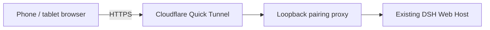

# dsh-remote-control

[简体中文](README.zh-CN.md)

Pair a phone browser with your running [DeepSeek Harness (DSH)](https://github.com/deepseek-ai/deepseek-harness) through a temporary Cloudflare HTTPS tunnel. Continue the same sessions, send messages, answer questions, approve actions, and stop tasks from your phone. No phone app, Cloudflare account, or custom domain is required.

This is an independent community plugin. For the current full phone experience, also install [dsh-mobile](https://github.com/slicenferqin/dsh-mobile), which adds a task-first phone workspace. Either plugin can be installed independently.

## Connection flow



## Features

- Explicit local switch to start or stop remote access; starts switched off.
- Short-lived, single-use pairing QR codes, with device-name confirmation before pairing.
- Multiple paired devices: four by default, configurable up to sixteen; rename or revoke each device separately.
- HTTP and WebSocket access to the existing DSH Host, with automatic credential renewal.
- A `remote_control` agent tool for status, renaming, revocation, and disconnecting all devices. Enabling access and issuing pairing codes stay in local Settings.

## Compatibility

- Node.js **22.19 or later**, DSH installed, and `pnpm` on `PATH` for profile package management.
- Declared DSH range: `>=0.2.1-rc.2 <0.3.0`. DSH plugin APIs are pre-stable; check compatibility before upgrading.
- Validated with a **DSH 0.2.1-rc.2 source build on macOS arm64**, including live browser/tunnel use. This is not an end-to-end validation claim for every OS, browser, or mobile network.
- The DSH Web origin must use **`localhost`, `127.0.0.1`, or `[::1]`**. The default `dsh web` listener uses `127.0.0.1`. LAN addresses and wildcard binds such as `0.0.0.0` or `[::]` are unsupported by this bridge.

## Install and start

Install `cloudflared` yourself on the computer running DSH:

```sh
# macOS
brew install cloudflared
```

```powershell
# Windows
winget install Cloudflare.cloudflared
```

For other platforms, use the [official cloudflared releases](https://github.com/cloudflare/cloudflared/releases). Put the executable on `PATH`, or set `cloudflaredPath` in the plugin configuration.

Install the tagged community release into the Web profile:

```sh
dsh plugin --profile web add github:slicenferqin/dsh-remote-control#v0.2.0
```

For the full phone experience, optionally add the phone workspace to the same profile:

```sh
dsh plugin --profile web add github:slicenferqin/dsh-mobile#v0.1.0
```

Start DSH with `dsh web` (or `dsh --profile web`). If it is already running, restart that profile after the CLI installation, then refresh the local page. Open the authenticated local browser page printed by DSH. Release tarballs are also available from [GitHub Releases](https://github.com/slicenferqin/dsh-remote-control/releases); npm publication is not required.

## Pair and use

1. On the computer, open **Settings → Remote control** and enable remote access.
2. Wait for the Quick Tunnel and QR code. First startup can take nearly a minute, depending on the network. Quick Tunnels have temporary domains, with no stable hostname.
3. Scan the QR code with the phone camera and open the pairing page in a browser.
4. **Fill in or confirm the device name, then tap “配对并进入” (Pair and enter).** The page does not submit automatically. Invalid names do not consume the pairing code.
5. Use the existing DSH sessions from the phone. Browsers share one Host and its records, while each browser can select a different session.
6. Rename or revoke devices in the computer's Remote control settings. With dsh-mobile installed, a paired phone can also rename itself under **Device**.

The computer must stay awake, online, and running DSH. Generate a new QR code for each additional device. Pairing links last two minutes by default and can be claimed once; generating a new code invalidates the previous unclaimed one.

## Credentials and session lifetime

Access credentials last **8 hours** by default. A rotating refresh credential has a **rolling 10-day** lifetime, reset after each successful refresh. The browser normally renews access **5 minutes before expiry**, and can transparently recover after a background pause or a fresh page/browser startup while its refresh credential remains valid.

**The rolling window applies only while the same remote entry remains running and the device has not been revoked.** Turning remote access off, restarting DSH, reloading/unloading the Host plugin, or creating an entry with a new tunnel domain clears that run's pairings. Pair again afterward; credentials do not survive these events. An ordinary browser-page refresh does not itself restart the Host plugin.

Revocation invalidates both credentials and closes that device's connections. Turning off remote access closes the bridge, tunnel, and all remote connections. Automatic renewal cannot reopen a disabled entry.

## Configuration

Edit the plugin's configuration in DSH's plugin settings. Defaults and supported ranges:

| Field | Default | Purpose / range |
| --- | --- | --- |
| `cloudflaredPath` | `cloudflared` | Executable name or absolute path on the DSH computer. |
| `tunnelProtocol` | `http2` | `http2`, `quic`, or `auto`; HTTP/2 avoids depending on outbound UDP. |
| `startupTimeoutSeconds` | `60` | Tunnel startup timeout, 10–180 seconds. |
| `pairingTtlSeconds` | `120` | Single-use pairing lifetime, 30–600 seconds. |
| `deviceTtlHours` | `8` | Access credential lifetime, 1–168 hours. |
| `refreshTtlDays` | `10` | Rolling refresh lifetime, 1–90 days; must exceed the access lifetime. |
| `refreshAheadSeconds` | `300` | Renew this early, 30–3600 seconds; must be shorter than the access lifetime. |
| `refreshRetrySeconds` | `30` | Retry delay after temporary renewal failure, 5–60 seconds. |
| `maxDevices` | `4` | Maximum paired devices, 1–16. |
| `heartbeatSeconds` | `15` | Keepalive for the local management status stream, 5–60 seconds. |

The plugin uses its own empty cloudflared configuration and a loopback bridge; it does not edit your existing Cloudflare configuration. No change to DSH's default listener or trust list is needed. If a custom listener causes `LOOPBACK_REQUIRED`, restart DSH with `dsh web --host 127.0.0.1` (or `--host ::1`).

## Security scope and limits

**A paired device receives owner access to this DSH Host, including available local-file and command capabilities, subject to the Host's permission policy.** Pair only browsers you trust. There is no read-only role or exclusive control lock, and pairing does not lock the computer. This operates DSH sessions; it is not OS screen sharing or general desktop control.

Pairing secrets are kept in URL fragments and claimed through a same-origin POST, so opening a link preview does not consume a code. The DSH launch token is not sent to the phone or placed in the QR code or logs. Per-device access and refresh cookies use **HttpOnly, Secure, and SameSite=Strict**; client JavaScript does not read their values. The bridge also uses DSH authentication and validates external Host/Origin headers. Local authenticated Settings alone expose the enable/pair management endpoints; those endpoints are blocked through the remote proxy.

Cloudflare carries the external HTTPS traffic. Availability depends on Cloudflare, local connectivity, and the phone's network. Quick Tunnels do not provide a stable domain or a persistent remote-access service. This release does not support LAN targets, wildcard listeners, custom domains, or named tunnels.

## Development and tests

Source, build scripts, and tests are included so the client bundle can be rebuilt. From a checkout or extracted source package:

```sh
pnpm install --ignore-scripts
pnpm run build
pnpm run check
pnpm test
```

The behavior tests cover pairing and expiry, origin checks, HTTP/WebSocket forwarding, credential renewal, revocation, startup cancellation, and cleanup. They do not replace testing the actual phone/network combination. For local development, install the checkout with `dsh plugin --profile web add .` from this repository's root, then restart the Web profile and refresh its page.

## License

[MIT](LICENSE).
