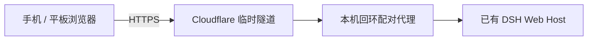

# dsh-remote-control

[English](README.md)

通过临时 Cloudflare HTTPS 隧道，将手机浏览器配对到正在运行的 [DeepSeek Harness（DSH）](https://github.com/deepseek-ai/deepseek-harness)。在手机上继续同一批会话、发送消息、回答问题、审批操作或停止任务。无需手机客户端、Cloudflare 账号或自备域名。

这是独立维护的社区插件。当前完整手机体验建议同时安装 [dsh-mobile](https://github.com/slicenferqin/dsh-mobile)，获得以任务为中心的手机工作台。两个插件也可以分别独立安装。

## 连接方式



## 功能

- 在本机显式开启或关闭远程入口；插件始终以关闭状态启动。
- 短时、一次性配对二维码，确认设备名后才提交配对。
- 默认支持四台配对设备，可配置到十六台；可逐台重命名和撤销。
- 通过 HTTP / WebSocket 访问现有 DSH Host，并自动续期凭证。
- `remote_control` agent 工具可查看状态、重命名、撤销设备或断开所有设备；开启入口和签发配对码仍在本机设置中操作。

## 兼容性

- **Node.js 22.19 或更新版本**，已安装 DSH；profile 包管理需要 `PATH` 中有 `pnpm`。
- 声明的 DSH 版本范围：`>=0.2.1-rc.2 <0.3.0`。DSH 插件 API 尚未稳定，升级前请核对兼容性。
- 已在 **DSH 0.2.1-rc.2 源码构建版、macOS arm64** 上完成 live 浏览器和隧道验证；这不代表所有操作系统、浏览器和手机网络均经过端到端验证。
- DSH Web origin 的主机名必须是 **`localhost`、`127.0.0.1` 或 `[::1]`**。默认 `dsh web` 监听 `127.0.0.1`。桥接不支持 LAN 地址或 `0.0.0.0`、`[::]` 等通配绑定。

## 安装与启动

请自行在运行 DSH 的电脑上安装 `cloudflared`：

```sh
# macOS
brew install cloudflared
```

```powershell
# Windows
winget install Cloudflare.cloudflared
```

其他平台使用 [cloudflared 官方发行版](https://github.com/cloudflare/cloudflared/releases)。将可执行文件加入 `PATH`，或在插件配置中设置 `cloudflaredPath`。

通过 GitHub tag 将社区发行版安装到 Web profile：

```sh
dsh plugin --profile web add github:slicenferqin/dsh-remote-control#v0.2.0
```

如需完整手机体验，可在同一 profile 加装手机工作台：

```sh
dsh plugin --profile web add github:slicenferqin/dsh-mobile#v0.1.0
```

使用 `dsh web`（或 `dsh --profile web`）启动。若 DSH 已运行，CLI 安装后请重启该 profile，再刷新本机页面。打开 DSH 输出的已认证本机浏览器入口。[GitHub Releases](https://github.com/slicenferqin/dsh-remote-control/releases) 也提供发行压缩包，无需发布到 npm。

## 配对与使用

1. 在电脑打开 **设置 → 远程控制**，开启远程入口。
2. 等待 Quick Tunnel 建立并出现二维码。首次启动可能接近一分钟，取决于网络；临时隧道没有稳定域名。
3. 手机相机扫码，在浏览器打开配对页。
4. **填写或确认设备名称，再点击「配对并进入」。** 页面不会自动提交；无效名称不会消耗配对码。
5. 手机进入现有 DSH 会话。不同浏览器共享同一 Host 及记录，但可以各自选择不同会话。
6. 在电脑的远程控制设置中重命名或撤销设备。安装 dsh-mobile 后，已配对手机也可在 **设备** 中修改自己的名称。

电脑需要保持唤醒、联网并持续运行 DSH。每增加一台设备请生成新二维码。配对链接默认两分钟有效，只能领取一次；生成新码会使未领取的旧码失效。

## 凭证与有效期

访问凭证默认有效 **8 小时**。刷新凭证采用**滚动 10 天**有效期，每次成功刷新重新计时。浏览器通常在访问凭证到期前 **5 分钟**续期；只要刷新凭证仍有效，手机从后台恢复、重新打开页面或浏览器冷启动时也可透明续期。

**滚动窗口只适用于同一远程入口持续运行、且设备未被撤销的情况。** 关闭远程控制、重启 DSH、重载或卸载 Host 插件，或建立新域名的隧道入口，都会清空本轮配对，之后需要重新扫码。凭证不跨这些事件保留；普通浏览器页面刷新本身不会重启 Host 插件。

撤销设备会作废它的两种凭证并关闭连接。关闭远程入口会关闭桥接、隧道及全部远程连接。自动续期不能重新打开已关闭的入口。

## 配置

在 DSH 插件设置中编辑配置，字段及范围如下：

| 字段 | 默认值 | 含义及范围 |
| --- | --- | --- |
| `cloudflaredPath` | `cloudflared` | DSH 电脑上的可执行文件名或绝对路径。 |
| `tunnelProtocol` | `http2` | `http2` / `quic` / `auto`；HTTP/2 不依赖出站 UDP。 |
| `startupTimeoutSeconds` | `60` | 隧道启动超时，10–180 秒。 |
| `pairingTtlSeconds` | `120` | 一次性配对码有效期，30–600 秒。 |
| `deviceTtlHours` | `8` | 访问凭证有效期，1–168 小时。 |
| `refreshTtlDays` | `10` | 滚动刷新有效期，1–90 天；必须长于访问凭证寿命。 |
| `refreshAheadSeconds` | `300` | 提前续期时间，30–3600 秒；必须短于访问凭证寿命。 |
| `refreshRetrySeconds` | `30` | 临时续期失败后的重试间隔，5–60 秒。 |
| `maxDevices` | `4` | 配对设备上限，1–16。 |
| `heartbeatSeconds` | `15` | 本机管理页状态流的保活间隔，5–60 秒。 |

插件使用独立的空 cloudflared 配置和 loopback 桥接，不修改已有 Cloudflare 配置，也不需要改变 DSH 默认监听或信任列表。如果自定义监听触发 `LOOPBACK_REQUIRED`，请用 `dsh web --host 127.0.0.1`（或 `--host ::1`）重启 DSH。

## 安全范围与限制

**已配对设备具有该 DSH Host 的 owner 权限，包括 Host 权限策略允许的本机文件及命令能力。** 只配对可信浏览器。本版没有只读角色或排他控制锁，配对也不会锁定电脑。这是 DSH 会话操作界面，不是操作系统投屏或通用远程桌面。

配对凭证放在 URL fragment 中，通过同源 POST 领取，链接预览不会消耗配对码。DSH 启动 token 不发送到手机，也不写入二维码或日志。每台设备的访问和刷新 cookie 均使用 **HttpOnly、Secure、SameSite=Strict**，客户端 JavaScript 不读取凭证值。桥接同时使用 DSH 自带认证并校验外部 Host / Origin。开启入口和签发配对码的管理接口仅向本机已认证设置页开放，远程代理会阻断这些接口。

外部 HTTPS 流量经过 Cloudflare。可用性取决于 Cloudflare、电脑连接及手机网络；Quick Tunnel 不提供稳定域名或持久远程访问服务。本版不支持 LAN 目标、通配监听、自定义域名或命名隧道。

## 开发与测试

包中附带源码、构建脚本和测试，可重建客户端产物。在仓库根目录或解压后的源码包中执行：

```sh
pnpm install --ignore-scripts
pnpm run build
pnpm run check
pnpm test
```

行为测试覆盖配对与过期、来源校验、HTTP / WebSocket 转发、凭证续期、撤销、启动取消和资源清理；实际手机和网络组合仍需自行验证。本地开发可在仓库根目录运行 `dsh plugin --profile web add .` 安装 checkout，然后重启 Web profile 并刷新页面。

## 许可证

[MIT](LICENSE)。
